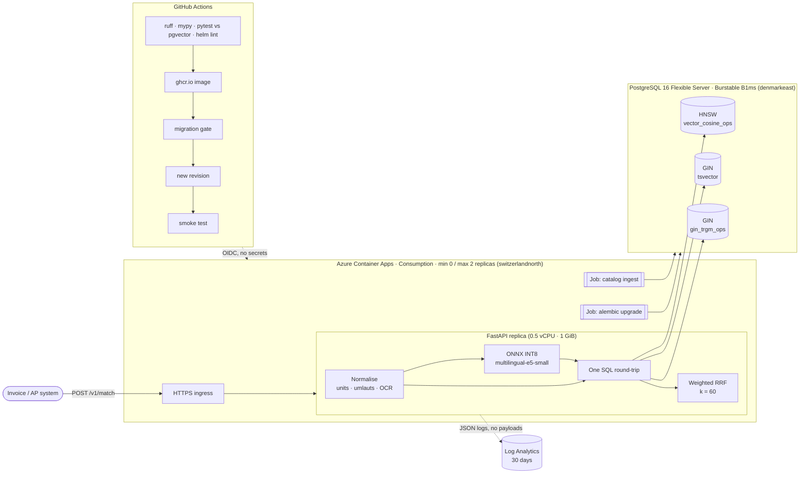

# Hybrid SKU & Invoice Semantic Matching Service

[](https://github.com/Vlad-vt/azure_pet/actions/workflows/ci.yml)
[](https://github.com/Vlad-vt/azure_pet/actions/workflows/deploy.yml)

Maps noisy supplier-invoice lines such as `MILSA. Speisequark MAGERSTUFE 0,25 KG` or
`Art.-Nr. 110932 REWE BI0 GEMUESEBRUEHE 140G` to the right catalog SKU. Three retrievers run
**inside one PostgreSQL 16 instance** — dense vectors (pgvector HNSW), full-text search (GIN
`tsvector`) and fuzzy trigrams (GIN `pg_trgm`) — and are merged with weighted **Reciprocal Rank
Fusion**. Embeddings come from a CPU-only INT8 ONNX `multilingual-e5-small`; the whole service
runs on Azure Container Apps with scale-to-zero for **≈ $0–5/month**.

**Live:** `https://skumatch-api.lemonisland-f8af8152.switzerlandnorth.azurecontainerapps.io/docs`
(scales to zero; the first request after idle takes ~25 s, and the database is stopped between
demos — `readyz` returns 503 until it is started).

## Highlights

- **Hybrid retrieval in a single SQL round-trip:** `UNION ALL` of three index-driven top-k CTEs,
  fused in Python with weighted RRF (`k = 60`, dev-tuned weights). `EXPLAIN ANALYZE` proves every
  branch uses its index ([`docs/explain_analyze.md`](docs/explain_analyze.md)).
- **Domain normalisation:** units (`0,5 kg` ≡ `500g`, `6 x 0,33 l` ≡ `6er 330ml`), umlauts
  (`Käse` ≡ `Kaese`), OCR repair (`C0CA` → `coca`, `O,5L` → `0,5l`), article-number stripping.
- **Real data + reproducible benchmark:** 8,000 German products from Open Food Facts and 1,200
  labelled invoice lines from a seeded generator (4 failure slices).
- **Honest evaluation:** dev/test split, paired bootstrap + exact sign tests, ablations, MLflow,
  documented negative results ([`docs/eval_report.md`](docs/eval_report.md)).
- **Production plumbing:** FastAPI, async SQLAlchemy 2.0, Alembic migration gate, structured logs
  without payloads, Bicep IaC, OIDC CI/CD, Helm chart with PgBouncer for Kubernetes.

## Architecture



## Benchmark (test split, 911 synthetic invoice lines, 8,000 Open Food Facts DE SKUs)

<!-- EVAL:START -->

| System | R@1 | R@5 | R@10 | MRR@10 | NDCG@10 |
|---|---|---|---|---|---|
| Dense (HNSW) | 0.942 | 0.985 | 0.990 | 0.961 | 0.968 |
| Lexical (FTS+Trigram RRF) | 0.935 | 0.992 | 0.999 | 0.960 | 0.970 |
| Hybrid RRF (equal weights) | 0.959 | 0.996 | 0.999 | 0.976 | 0.982 |
| Hybrid RRF (dev-tuned, shipped) | 0.969 | 0.997 | 0.998 | 0.982 | 0.986 |

Per-slice: [`docs/eval_report.md`](docs/eval_report.md).

<!-- EVAL:END -->

What it means — see [`docs/eval_notes.md`](docs/eval_notes.md):

- Hybrid is significantly better than Dense and than Lexical overall (p < 0.001), and on
  `ocr_typos` it beats both. On `hard_negatives` it beats Lexical but **ties** Dense.
- Lexical signals fix abbreviations (Dense 0.83 → Hybrid 0.90 R@1); dense signals fix OCR damage
  (Lexical 0.86 → Hybrid 0.99 R@1).
- Trigram-only is a strong baseline on this character-level synthetic noise and ties Hybrid —
  reported, not hidden.

Latency (embedding + SQL + fusion, 1 ORT thread):

| Setup | p50 | p95 |
|---|---|---|
| Local PostgreSQL, in-process | 27.9 ms | 44.9 ms |
| Local, HTTP via PgBouncer | 34.5 ms | 52.6 ms |
| **Azure, live** (ACA 0.5 vCPU, DB in another region — see [ADR-003](docs/adr/003-cross-region-topology.md)) | **50.7 ms** | **82.7 ms** |

Live R@1 on 100 test lines against the deployed API: 0.94.

## API

| Method | Path | Purpose |
|---|---|---|
| `POST` | `/v1/match` | `{"text": "...", "top_k": 5, "mode": "hybrid\|dense\|lexical"}` → ranked SKUs with per-retriever ranks and `unit_match` |
| `POST` | `/v1/match/batch` | up to 100 lines, embedded in one batch |
| `GET` | `/v1/skus/{id}` | catalog lookup |
| `GET` | `/healthz` | liveness (no DB call) |
| `GET` | `/readyz` | readiness (DB ping, 503 when the database is stopped) |

```bash
curl -s -X POST "$URL/v1/match" -H 'content-type: application/json' \
  -d '{"text": "MILSA. Speisequark MAGERSTUFE 0,25 KG", "top_k": 1}'
# -> Milsani · Speisequark Magerstufe · 250g  ranks {dense: 1, fts: 1, trgm: 1}  unit_match: true
```

## Quickstart (local)

```bash
make install            # Python 3.12 venv via uv, locked deps
make model              # INT8 ONNX model (pinned revision) -> ./models
make up                 # pgvector/pgvector:pg16 + PgBouncer (transaction pooling)
cp .env.example .env
make ingest             # Alembic migrations + embed + load 8,000 SKUs
make serve              # http://localhost:8000/docs
make check              # ruff + mypy --strict + pytest (unit + integration)
make eval               # benchmark -> docs/eval_report.md, MLflow in ./mlruns
```

## Repository layout

| Path | Contents |
|---|---|
| `src/skumatch/normalize/` | unit, umlaut and OCR normalisation |
| `src/skumatch/retrieval/` | SQL for the three retrievers, RRF fusion, match engine |
| `src/skumatch/api/` | FastAPI app and schemas |
| `src/skumatch/data/synth.py` | seeded invoice-line generator (4 slices) |
| `src/skumatch/evaluation/` | metrics, significance tests, optional LLM judge |
| `migrations/` | Alembic (HNSW, GIN tsvector, GIN trigram) |
| `infra/bicep/` | Azure IaC (ACA, PostgreSQL B1ms, Log Analytics, jobs) |
| `infra/helm/skumatch/` | Kubernetes chart (Deployment, Service, HPA, PDB, PgBouncer, migration hook) |
| `infra/scripts/` | cleanup, deploy, OIDC setup, budget |
| `docs/adr/` | ADR-001 pooling on B1ms, ADR-002 ACA vs AKS TCO, ADR-003 cross-region topology |

## Cost analysis (Azure for Students)

| Component | Configuration | Expected monthly cost |
|---|---|---|
| Container Apps | Consumption, 0.5 vCPU / 1 GiB, **min 0** / max 2 replicas | **$0** at idle; demo traffic stays inside the free grant (180k vCPU-s, 360k GiB-s, 2M requests) |
| Container Apps Jobs | migrate (0.5 vCPU, ~30 s per deploy), ingest (1 vCPU, ~2 min, rare) | < $0.05 |
| PostgreSQL Flexible Server | Burstable **B1ms**, 32 GiB, no HA, no geo-backup, **stopped when idle** | compute ≈ $0.017/h only while running (~$12/month if never stopped); storage 32 GiB ≈ $3.7; covered by the 12-month free allowance (750 h B1ms + 32 GiB) where the offer includes it |
| Log Analytics | PerGB2018, 30-day retention, 0.15 GB/day cap | ≈ $0 (first 5 GB/month free) |
| Container registry | ghcr.io | $0 |
| CI/CD | GitHub Actions | $0 (free minutes) |
| **Total** | | **≈ $0–5/month** (worst case without free allowances ≈ $4 with the DB stopped) |

Guardrails: `db-power.yml` stops the database every 5 days (Azure auto-starts a stopped server
after 7 days) and on demand; the deploy workflow restores the database's prior power state;
budget alerts at $5 / $15 / $30 (`infra/scripts/create_budget.sh`). No AKS, GPU, Redis, Azure
OpenAI or paid ACR — see [ADR-002](docs/adr/002-aca-vs-aks-tco.md).

## Data & licences

Product data © Open Food Facts contributors, [ODbL 1.0](https://opendatacommons.org/licenses/odbl/1-0/).
Model: [`intfloat/multilingual-e5-small`](https://huggingface.co/intfloat/multilingual-e5-small)
(MIT), INT8 ONNX export by Xenova. Code: MIT.
